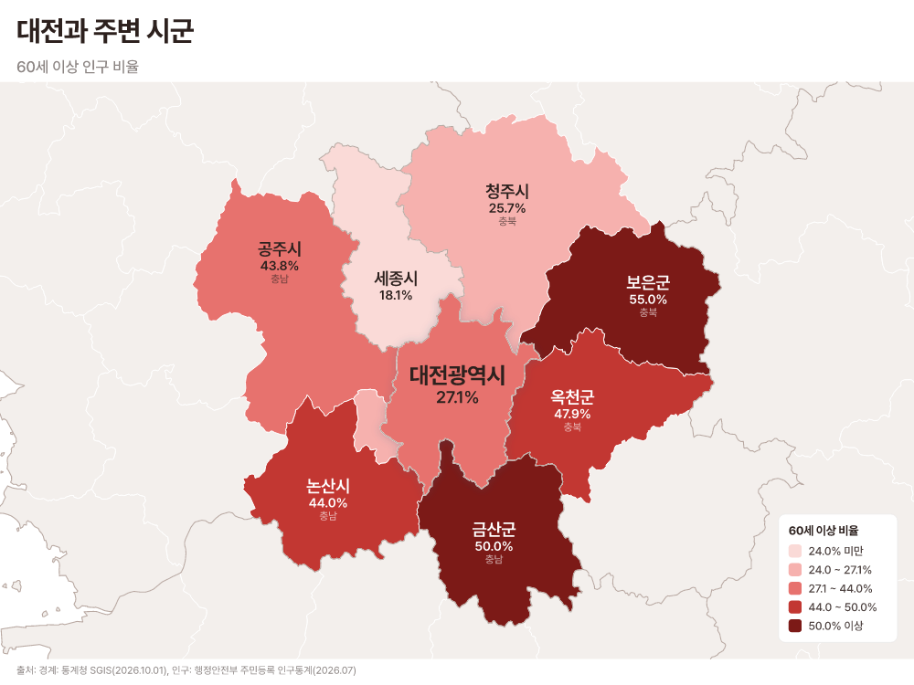
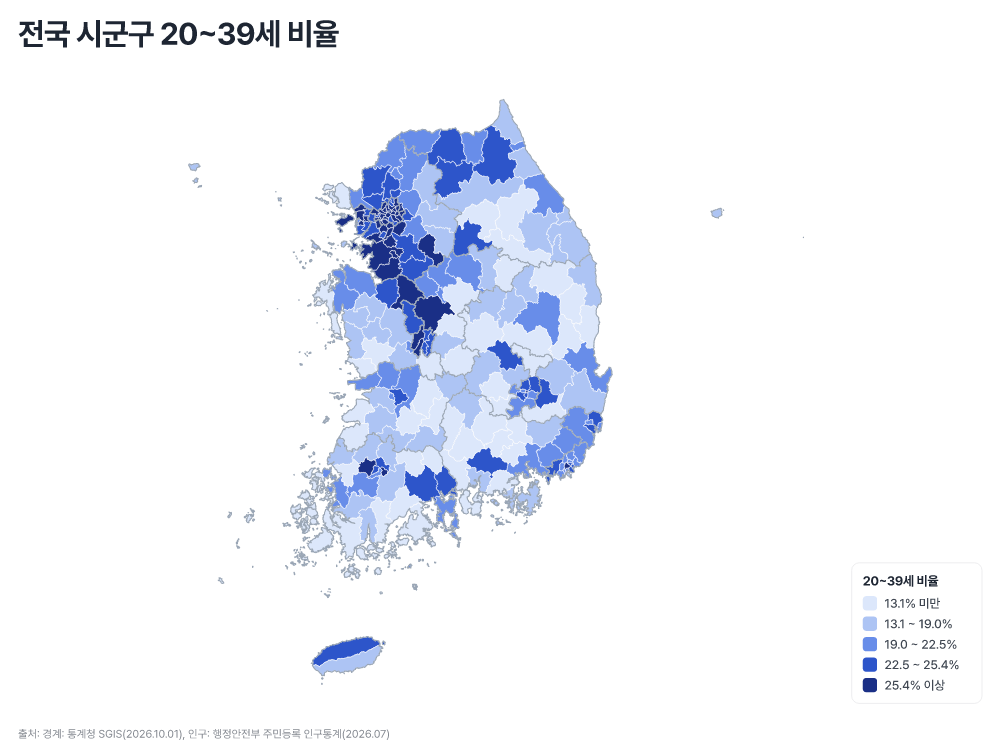
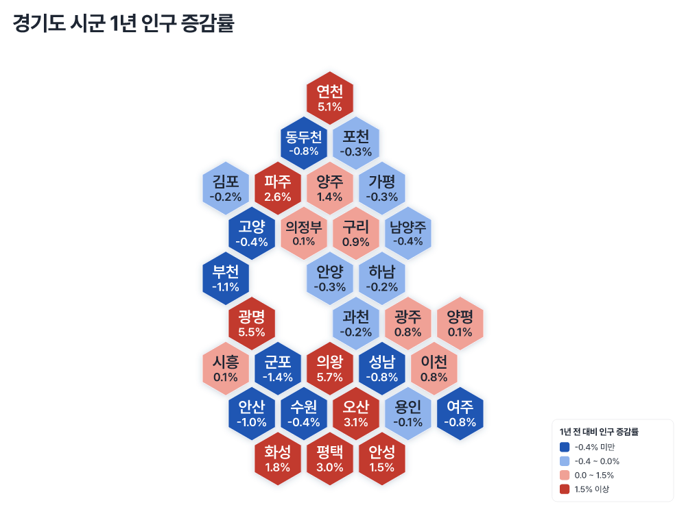
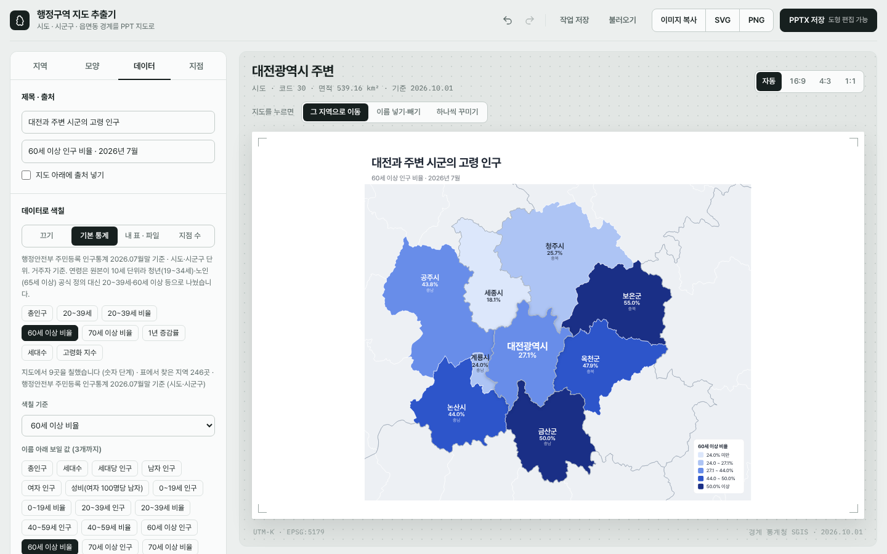

# 대한민국 행정구역 지도 (시도 · 시군구 · 읍면동)

보고서와 PPT에 넣을 대한민국 지도를 만드는 도구입니다. 지역을 고르면 주변 시군과 함께 그리고, 인구 통계나 여론조사 표로 색을 칠하고, 주소로 핀을 찍어 **SVG · PNG · PPTX** 로 저장합니다.
브라우저에서 눌러 만들 수도 있고, 명령줄이나 Claude Code · Codex 에게 말로 시켜서 만들 수도 있습니다.

| 주변 지역 + 기본 통계 | 전국 시군구 | 육각 타일 지도 |
| --- | --- | --- |
|  |  |  |

<sub>위 그림은 모두 `node tools/krmap.mjs render ...` 한 줄로 만들었습니다 ([명령](#예시-그림-다시-만들기)).</sub>

## 할 수 있는 것

- **주변 지역 지도**: 대전광역시를 고르면 둘러싼 세종 · 청주 · 보은 · 옥천 · 금산 · 논산 · 계룡 · 공주를 함께 그립니다. 맞닿은 곳만, 또는 두 겹까지.
- **원하는 지역만 골라 한 장으로**: 시도 / 시군구 / 읍면동 단위를 정하고 지역을 넣고 뺍니다. 고르지 않은 곳은 흐리게 두거나 아예 뺍니다.
- **지도 모양**: 실제 지도, 지역끼리 벌려 놓기, 네모 · 육각 **타일 지도**, 지역 하나씩 색 · 이름 · 위치 바꾸기.
- **지역 이름**: 모두 넣기 / 모두 빼기 / 고른 것만.
- **기본 통계 내장**: 행정안전부 주민등록 인구통계(2026년 7월말)의 시도 · 시군구별 인구, 세대, 연령대, 청년 · 고령 비율, 1년 증감을 바로 골라 칠합니다.
- **내 표로 색칠**: 엑셀에서 복사한 표나 CSV 를 넣으면 값 · 비율 · 여론조사 1위로 칠하고 범례와 값을 붙입니다.
- **지점 핀**: 이름 · 주소(또는 위도 · 경도) 목록을 넣으면 핀을 찍고, 분류별 색이나 지역별 지점 수로 칠합니다.
- **제목 · 부제 · 범례 · 출처**를 그림 안에 넣습니다.
- **PPTX 는 지역 하나가 도형 하나**라 PowerPoint 에서 색을 바로 바꿀 수 있습니다.
- 경계는 **2026.10.01 기준** (시도 16 · 시군구 256 · 읍면동 3,559). 2026.7.1. 출범한 전남광주통합특별시를 반영했고, 광주 · 전남을 나눈 **17개 시도**로도 볼 수 있습니다.

## 어떻게 쓰나

| 이런 경우 | 이렇게 |
| --- | --- |
| 지도 한두 장을 눌러서 만들고 싶다 | [웹 도구](#1-웹-도구) — `web/index.html` 을 브라우저로 열기 |
| 지금 바로 SVG 가 필요하다 | [미리 만든 SVG](#2-미리-만든-svg) — `svg/` 폴더의 521장 |
| 여러 장을 같은 형식으로, 또는 에이전트에게 맡기고 싶다 | [자동화](#3-자동화-명령줄--claude-code--codex) — `krmap` 명령줄, Claude Code · Codex |

---

## 1. 웹 도구

`web/index.html` 을 브라우저로 열면 됩니다. 설치도 서버도 필요 없습니다.
왼쪽에서 설정하면 오른쪽 미리보기가 바로 바뀌고, 위의 버튼으로 SVG · PNG · PPTX 를 저장합니다. 그림 비율(자동 · 16:9 · 4:3 · 1:1)은 미리보기 위에서 고릅니다.



설정판은 네 탭입니다.

| 탭 | 하는 일 |
| --- | --- |
| **지역** | 지도 방식(주변 지역 보기 / 영역 직접 고르기 / 전국), 지역 찾기, 주변 몇 겹 · 어느 단위, 안쪽 나누기, 일반구 나누기, 17개 시도 |
| **모양** | 색 테마 6종 · 색 직접 고르기, 고른 지역 띄우기(그림자), 이웃끼리 색 다르게, 배치(실제 · 벌려 놓기 · 네모 타일 · 육각 타일), 지역 이름 |
| **데이터** | 제목 · 부제 · 출처, 기본 통계 / 내 표 / 지점 수로 색칠(기준, 단계 · 색, 이름 아래 보일 값), 색 그룹, 범례 |
| **지점** | 주소 · 좌표 목록 붙여넣기, 핀 모양 · 색 · 크기 · 이름, 분류별 색 |

그 밖에

- **지역 찾기**: `대전`, `유성구`, `정자동`처럼 일부만 써도 찾습니다. "중구"처럼 여러 곳인 이름은 "대전 중구"로.
- **지도 클릭**: 누른 지역이 새 대상이 됩니다(주변 지역 보기). 영역 직접 고르기에서는 넣고 뺍니다.
- **하나씩 꾸미기**: 지역을 눌러 그 지역만 색 · 이름을 바꾸거나 숨기고, 끌어서 옮깁니다.
- **작업 관리**: 되돌리기(Ctrl+Z) · 다시 하기(Ctrl+Shift+Z), 브라우저 자동 저장, 작업 파일(.json) 저장 · 불러오기, 이미지 복사(PPT 에 바로 붙여넣기).
- **목록 복사**: "대전광역시 주변 8곳: 세종시(세종), 청주시(충북), …"

### 데이터로 색칠

**기본 통계** — 데이터 탭에서 "기본 통계"를 고르면 지표를 바로 고릅니다(시도 · 시군구 단위).

| 묶음 | 지표 |
| --- | --- |
| 인구 · 세대 | 총인구, 세대수, 세대당 인구, 남자 · 여자, 성비 |
| 연령대 | 0~19세, 20~39세, 40~59세, 60세 이상, 70세 이상 (수 · 비율), 10세 단위 연령, 고령화 지수(60세 이상 ÷ 0~19세) |
| 변화 | 1년 전 대비 인구 증감 · 증감률 |

> 원본이 10세 단위라 법정 청년(19~34세) · 노인(65세 이상)은 만들 수 없어 실제 연령 구간으로 이름을 붙였습니다.
> 법정 기준이 필요하면 아래 "행정안전부 연령별 인구 파일"을 넣으세요.

**내 표** — 엑셀에서 복사해 붙여넣거나 CSV 를 엽니다. 첫 열은 지역 이름이나 행정기관코드.

| 표 | 칠하는 법 |
| --- | --- |
| 숫자 열 (인구, 매출 …) | 고른 열의 값으로 3~7단계 (같은 개수씩 / 같은 간격), 색 7가지(색각 친화 포함) |
| 두 열 | A ÷ B 비율 (청년 수 ÷ 총인구 등) |
| 여론조사 (후보 · 정당 · 찬반별 %) | 1위 항목 색, 1 · 2위 차이가 작을수록 옅게 |
| 글자 열 (권역, 담당자 …) | 분류마다 다른 색 |
| 행정안전부 [연령별 인구현황](https://jumin.mois.go.kr/) (1세 단위) | 그대로 열면 청년(19~34세) · 노인(65세 이상) · 유소년 · 생산연령 수와 비율, 노령화지수를 계산 |

- 지도보다 잘게 나뉜 표(읍면동 숫자로 시군구 지도)는 더해서 맞춥니다. EUC-KR 파일도 읽습니다.
- 단계와 범례는 지금 지도에 보이는 지역만으로 정합니다.
- 표에서 지도에 못 맞춘 이름, 여러 곳인 이름은 따로 알려 줍니다.

**지점 핀** — `이름 ⇥ 주소 ⇥ 분류` 또는 `이름 ⇥ 위도, 경도` 줄을 붙여넣습니다.
위도 · 경도는 정확한 자리에, 주소는 인터넷 주소 검색(OpenStreetMap)으로 찾습니다. 검색이 막힌 곳(claude.ai 화면 등)에서는 주소 속 동 · 시군구의 가운데에 대략 찍고, 어떻게 찾았는지 목록에 표시합니다.

### PPT 에서 쓰는 법

- **PPTX** (추천): 16:9 슬라이드 한 장. 지역마다 이름 붙은 도형이라 선택 창(Alt+F10)에서 골라 색을 바꾸거나 지웁니다. 출처는 오른쪽 아래에 자동으로 들어갑니다.
- **SVG**: PowerPoint 2019 / Microsoft 365 에서 `삽입 → 그림`으로 넣고 `마우스 오른쪽 → 도형으로 변환`하면 지역별 도형으로 풀립니다.
- **PNG**: 4000px 안팎 고해상도, 기본 투명 배경(흰 바탕 옵션).

---

## 2. 미리 만든 SVG

웹 도구를 열지 않아도 쓸 수 있게 `svg/` 에 521장을 만들어 두었습니다.

| 폴더 | 내용 | 예 |
| --- | --- | --- |
| `01_전국` | 전국 시도(16 · 17개) / 시군구 / 시군구(일반구) | `전국_시도_17개.svg` |
| `02_시도` | 시도 하나를 시군구로 나눈 지도 (광주 · 전라남도 포함 18장) | `대전광역시.svg` |
| `03_시도_주변` | 시도 + 맞닿은 시군구 | `대전광역시_주변.svg` |
| `04_시군구` | 시군구 하나를 읍면동으로 나눈 지도 | `경기_수원시.svg` |
| `05_시군구_주변` | 시군구 + 맞닿은 시군구 | `대전_유성구_주변.svg` |
| `06_타일` | 전국 시도(16 · 17개) · 시군구 네모 · 육각, 시도별 시군구 육각 | `서울특별시_시군구_육각.svg` |

지역 `<path>` 에는 `id="대전광역시_유성구"` 처럼 이름이 붙어 있고, 그룹은 `배경 / 주변 / 대상 / 대상_내부 / 시도경계 / 지명` 으로 나뉩니다.

---

## 3. 자동화: 명령줄 · Claude Code · Codex

웹 도구와 **같은 그리기 코드**를 Node 에서 돌립니다. 설정(JSON) 하나가 지도 한 장이라, 같은 형식의 지도를 여러 장 만들거나 에이전트에게 맡기기 좋습니다.

```bash
npm install          # Node 18 이상, 처음 한 번
npm test             # 7개 확인 (인터넷 필요 없음)
```

### 명령줄 `krmap`

```bash
# 대전과 주변 시군, 60세 이상 비율로 칠하고 인구를 이름 아래에
node tools/krmap.mjs render --region 대전광역시 --stat "60세 이상 비율" --stat-labels pop \
  --title "대전 주변 고령 인구" --source

# 충남 시군구 육각 타일 + 여론조사 표
node tools/krmap.mjs render --regions 충청남도 --unit 시군구 --layout 육각 --data 여론조사.csv --poll --format pptx

# 설정 파일로 (웹 도구에서 "작업 저장"한 파일도 됨)
node tools/krmap.mjs render spec.json --format png,pptx --out out/보고서

# 지도 없이 값만
node tools/krmap.mjs find 중구                                    # 같은 이름이 어디어디 있는지
node tools/krmap.mjs neighbors 대전광역시 --unit 시군구
node tools/krmap.mjs indicators                                   # 기본 통계 지표 목록
node tools/krmap.mjs stats --in 경기도 --unit 시군구 --indicators pop,old60R
```

- 파일은 기본으로 `out/` 에 저장됩니다(git 에 올라가지 않음). 모든 명령에 `--json` 을 붙이면 결과가 JSON 입니다.
- 전체 옵션은 `node tools/krmap.mjs help`. `npm link` 를 하면 `krmap` 으로 바로 부릅니다.
- 글꼴은 **프리텐다드**(Pretendard)입니다. PNG 는 `npm install` 로 함께 받는 프리텐다드로 그려서 어느 컴퓨터에서 만들어도 같고, 다른 글꼴을 쓰려면 `--font 글꼴.ttf`.

설정(spec) 예:

```json
{
  "region": "대전광역시",
  "stat": "60세 이상 비율",
  "statLabels": ["pop"],
  "theme": "코랄",
  "title": "대전과 주변 시군의 고령 인구",
  "source": true,
  "formats": ["pptx", "png"],
  "out": "out/대전_고령.pptx"
}
```

칸 전부(지도 방식, 모양, 데이터, 그룹, 핀 …)는 **[docs/automation.md](docs/automation.md)** 에 있습니다.

### Claude Code

이 폴더에서 Claude Code 를 열고 말로 시키면 됩니다.

> 대전이랑 주변 시군 고령 인구 지도 PPT 로 만들어줘
> 이 여론조사 표로 충남 시군 육각 타일 지도 그려줘

`korea-map` 스킬(`.claude/skills/korea-map/`)이 지역 이름 확인 → 지표 고르기 → 지도 만들기 → 결과 확인 순서를 알려 주고,
`.mcp.json` 에 적힌 MCP 서버가 처음 열 때 쓸지 묻습니다. 다른 폴더에서도 쓰려면:

```bash
claude mcp add korea-map --scope user -- node /절대/경로/tools/mcp-server.mjs
```

### Codex

저장소 안에서는 `AGENTS.md` 를 읽고 명령줄을 바로 씁니다. MCP 로 붙이려면 `~/.codex/config.toml`:

```toml
[mcp_servers.korea-map]
command = "node"
args = ["/절대/경로/tools/mcp-server.mjs"]
```

### MCP 서버

명령줄과 같은 엔진 위의 얇은 층입니다. 명령줄만으로도 충분하지만, MCP 로 붙이면

- `render_map` 이 **미리보기 그림을 결과에 함께** 돌려줘서 에이전트가 지도를 보고 스스로 고칩니다.
- 이 저장소 밖에서 작업할 때나, 명령을 실행할 수 없는 클라이언트에서도 씁니다.

| 도구 | 하는 일 |
| --- | --- |
| `find_region` | 이름 · 코드로 지역 찾기 (애매한 이름은 후보 목록) |
| `list_neighbors` | 맞닿은 주변 지역 |
| `list_indicators` · `get_stats` | 기본 통계 지표 목록 · 값 |
| `locate_pins` | 주소 · 좌표가 어느 지역인지 |
| `render_map` | 설정 → SVG · PNG · PPTX 파일 + 요약 + 미리보기 그림 |
| `map_spec_reference` | 설정 설명서 (docs/automation.md) |

### 예시 그림 다시 만들기

맨 위 그림 세 장은 이렇게 만들었습니다.

```bash
K="node tools/krmap.mjs render --format png --width 1000 --png-scale 1 --background --aspect 4:3"
$K --out docs/images/around.png --region 대전광역시 --stat old60R --stat-labels old60R --title "대전과 주변 시군" --subtitle "60세 이상 인구 비율" --source --theme 코랄
$K --out docs/images/national.png --national 시군구 --stat youngR --labels none --title "전국 시군구 20~39세 비율" --source
$K --out docs/images/tiles.png --regions 경기도 --unit 시군구 --layout 육각 --stat yoyR --palette diverge --title "경기도 시군 1년 인구 증감률"
```

---

## 4. 데이터 다시 만들기

**경계** — 행정구역이 바뀌면 최신 경계로 다시 만듭니다.

```bash
pip install -r scripts/requirements.txt
python scripts/build_data.py            # 최신 시점 (특정 시점: python scripts/build_data.py 20261001)
node scripts/export_svgs.js             # svg/ 다시 만들기 (특정 지역만: node scripts/export_svgs.js 대전)
```

- `build_data.py` 는 경계를 받아 `web/data/base.js`(시도 · 시군구), `web/data/emd.js`(읍면동)로 저장하고,
  모든 단위 조합(시도 ↔ 시군구 ↔ 읍면동)의 **인접 관계를 미리 계산**합니다. 50m 이내로 맞닿으면 이웃입니다.
  바다 건너 섬(제주, 울릉 등)은 맞닿은 지역이 없습니다.
  전남광주통합특별시가 있는 시점이면 광주(29) · 전남(46)으로 나눈 경계와 인접표도 함께 만듭니다.
- 좌표는 EPSG:5179(UTM-K)를 10m 격자로 옮긴 값이라 지도가 위아래로 눌리지 않습니다.

**기본 통계** — `data/mois/` 의 행정안전부 월간 CSV(연령별인구현황, 주민등록인구및세대현황)에서 만듭니다.
새 달 파일을 [주민등록 인구통계](https://jumin.mois.go.kr/)에서 받아 넣고 `python scripts/build_stats.py` 를 돌리면 `web/data/stats.js` 가 바뀝니다.

**타일 배치** — 그릴 지역들의 실제 경계 안에 격자 칸을 깔고(칸 수가 지역 수보다 조금 많아지는 가장 큰 칸), 헝가리안 할당으로 지역마다 실제 위치에서 가장 가까운 칸을 줍니다(R `geogrid` 와 같은 방식). 전국 시도 타일만 알아보기 쉬운 고정 배치를 씁니다.

## 폴더

```
web/                 웹 도구 (index.html) 와 그리기 엔진
  render.js            경계 → 장면 → SVG (브라우저 · Node 공용)
  datafill.js          표 읽기 · 색칠
  pins.js              주소 · 좌표 → 지도 위치
  state.js             설정 → 그리기 옵션 (웹 · 명령줄 · MCP 공용)
  pptx.js              장면 → PowerPoint 도형
  app.js               웹 화면
  data/                경계 · 인접표 · 기본 통계 (scripts/ 가 만듦)
tools/               krmap 명령줄, MCP 서버, 테스트
svg/                 미리 만든 SVG 521장
scripts/             경계 · 통계 · SVG 만들기
data/mois/           행정안전부 인구통계 원본 CSV
docs/                자동화 설명서, README 그림
.claude/skills/      Claude Code 스킬
AGENTS.md            Codex 등 에이전트 안내
```

## 출처 · 라이선스

- **경계**: 통계청 SGIS 행정구역 경계 (공공누리 제1유형, 출처표시) — [vuski/admdongkor](https://github.com/vuski/admdongkor) 가공본(CC BY 4.0)을 단순화해서 썼습니다.
  발표 자료에는 "출처: 통계청 SGIS 행정구역 경계(2026.10.01)" 정도로 표시해 주세요. PPTX 에는 자동으로 들어갑니다.
- **인구 통계**: 행정안전부 주민등록 인구통계(2026년 7월말, 거주자 기준). 원본 CSV 는 [SimpleisNice/korea-population-dashboard](https://github.com/SimpleisNice/korea-population-dashboard) 에 공개된 사본을 썼습니다.
- **주소 검색**: © OpenStreetMap 기여자 (Nominatim).
- `web/vendor/pptxgen.bundle.js`: [PptxGenJS](https://github.com/gitbrent/PptxGenJS) 4.0.1 (MIT).
- 글꼴: [Pretendard](https://github.com/orioncactus/pretendard) 1.3.9 (SIL OFL 1.1, `web/vendor/fonts/`).
- 단순화한 경계라 실제와 수십 m 차이가 날 수 있습니다. 측량 · 법적 용도로는 쓰지 마세요.
